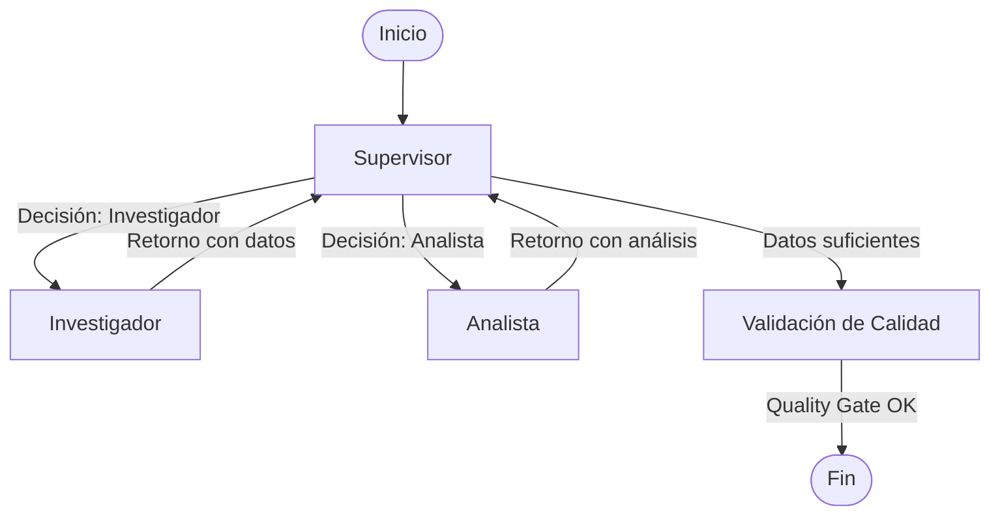

# Pre-entrega 6: Orquestador Multi-Agente Jerárquico de Análisis e Investigación

Proyecto correspondiente a la **Pre-entrega 6** del curso de IA / Agentes de Coderhouse. Consiste en la implementación de un prototipo funcional de un **Orquestador Multi-Agente Jerárquico** desarrollado con **LangGraph**, **LangChain**, **Pydantic** y soporte multiproveedor (**OpenAI**, **Groq** y **MockLLM**).

---

## Consigna y Requerimientos de la Entrega

### Objetivo
Desarrollar un **Orquestador Multi-Agente de Análisis e Investigación**. El sistema de orquestación debe ser capaz de procesar solicitudes complejas requeridas por el usuario que involucren al menos dos dominios de especialización y una fase de síntesis o validación final.

### Requerimientos Técnicos Cumplidos
1. **Topología Jerárquica:** Un nodo **Supervisor** central que actúa como router inteligente y controlador del flujo de trabajo.
2. **Especialistas ReAct con Herramientas Custom:**
   - **Agente de Búsqueda/Investigación (`research_agent.py`):** Utiliza herramientas locales de búsqueda (`buscar_informacion_mercado`, `calcular_metricas_rendimiento`) implementadas en `custom_tools.py` para recopilar datos.
   - **Agente de Análisis/Cómputo (`analyst_agent.py`):** Procesamiento cuantitativo y cálculo de métricas con manejo de excepciones mediante la herramienta `calculate_metrics`.
3. **Estado Compartido Estructurado (`state.py`):** Esquema `TeamState` basado en `TypedDict` con `add_messages`, almacenamiento de entregables (`research_data`, `analysis_data`) y contador de iteraciones (`step_count`).
4. **Flujo de Supervisión y Salida Estructurada:** Uso de `RouterSchema` con `with_structured_output` (y respaldo determinista) para validar la suficiencia de los datos.
5. **Validación Profunda de Calidad:** El sistema no solo verifica que los datos existan, sino que evalúa la longitud y la ausencia de errores antes de finalizar. Además, incluye un **Nodo Dedicado de Validación (`Validacion`)** como paso previo al `FINISH`.
6. **Demostración Práctica:** Notebook ejecutable (`jupyter_notebook_demonstration.ipynb`) y script asíncrono (`main.py`).

---

## Diagrama Mermaid del Grafo


 
---
##Estructura del Repositorio 
```	
mi-api-agente/
   ├── agents/
   │   ├── research_agent.py   # Agente Investigador (usa custom_tools)
   │   └── analyst_agent.py    # Agente Analista (usa calculate_metrics)
   ├── custom_tools.py         # Herramientas funcionales locales
   ├── config.py               # Multiproveedor (Gemini, OpenAI, Groq, MockLLM)
   ├── graph.py                # StateGraph, Supervisor y Nodo de Validación
   ├── main.py                 # Script ejecutable asíncrono
   ├── state.py                # Esquema TeamState
   ├── jupyter_notebook_demonstration.ipynb # Demostración del flujo
   ├── README.md               # Documentación
   ├── .env.example           # Plantilla de variables de entorno
   └── requirements.txt        # Dependencias
```
---


## Justificación de la Topología Elegida

Se seleccionó una **Topología Jerárquica (Hub-and-Spoke / Supervisor-Workers)** por los siguientes motivos de arquitectura de software:

1. **Desacoplamiento y Especialización Estricta (SRP):**  
   Cada agente especialista (Investigador y Analista) opera como una unidad con responsabilidad única. El investigador se enfoca exclusivamente en consumir herramientas externas y recolectar información, mientras que el analista procesa cuantitativamente esa información sin preocuparse por la fase de recolección.
2. **Control Centralizado y Rúbrica de Validación:**  
   Al hacer que todas las aristas de retorno pasen obligatoriamente por el Supervisor, nos aseguramos de que exista un nodo de validación en cada iteración. El supervisor evalúa si se han completado los requerimientos de la consigna antes de dar por finalizada la tarea (FINISH).
3. **Escalabilidad del Sistema:**  
   Esta topología permite agregar nuevos agentes especialistas (por ejemplo, un Agente Redactor o un Agente de Control de Calidad) añadiendo únicamente el nodo correspondiente al grafo y la opción en el Literal de la salida estructurada del Supervisor, sin modificar la lógica interna de los demás nodos.

### Detalle de las Herramientas Utilizadas
- **`buscar_informacion_mercado(tema)`:** Consulta una base de datos simulada de métricas de tecnología/mercado, permitiendo búsquedas con coincidencia parcial. Esencial para dar contexto al Investigador sin depender de APIs externas.
- **`calcular_metricas_rendimiento(valores)`:** Toma listas de números o texto con datos cuantitativos y calcula sumas, promedios, mínimos y máximos.
- **`calculate_metrics(numbers)`:** Herramienta interna del Agente Analista para realizar el cómputo matemático básico.

---

## Manejo de Conflictos y Prevención de Bucles

Para cumplir con los estándares de resiliencia y evitar errores comunes en sistemas multi-agente, se implementaron dos estrategias principales:

### 1. Prevención del "Supervisor Infinito" (Bucles Eternos)
- **Contador de Pasos (`step_count`):** 
   El estado compartido `TeamState` mantiene un contador de iteraciones. Si el grafo alcanza un límite estricto de ejecuciones (`step_count >= 5`), el Supervisor fuerza la salida hacia `FINISH` independientemente de la respuesta del modelo, evitando costos excesivos en la API o bloqueos infinitos.
- **Criterio de Suficiencia Estricto:** 
   El Supervisor no solo verifica la presencia de los campos `research_data` y `analysis_data`, sino que evalúa que su longitud sea mayor a 20 caracteres y que no contengan palabras de error. Si ambos entregables pasan esta validación, la decisión conmuta a `FINISH` inmediatamente.

### 2. Aislamiento de Estado y Contaminación de Contexto
- En lugar de saturar la ventana de contexto enviando todo el historial de conversaciones e imágenes de metadatos a cada especialista, se utilizan campos dedicados en `TeamState`.
- Cada agente recibe solo el artefacto o instrucción específica que necesita para ejecutar su herramienta, reduciendo la latencia de inferencia y aumentando la precisión en las respuestas (*context clutter reduction*).